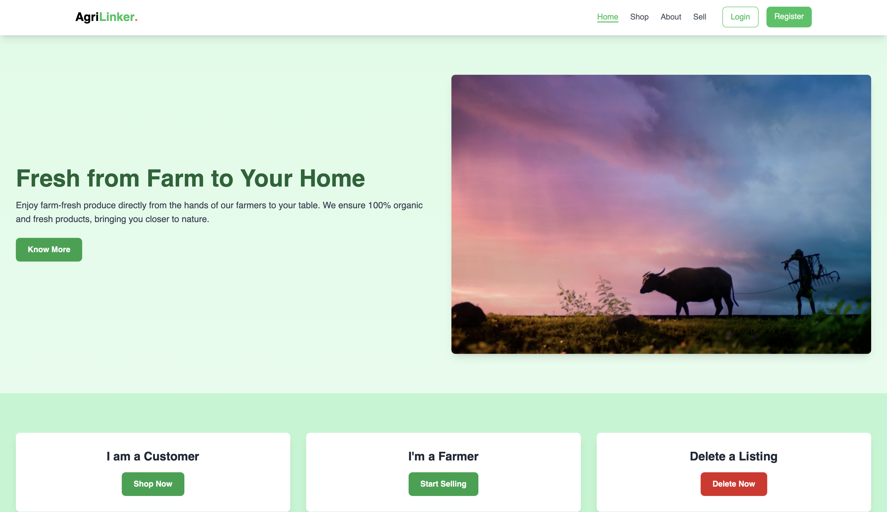

# 🌾 AgriLinker - Farm-to-Customer Marketplace

**AgriLinker** is a full-stack web application that connects farmers directly to customers, eliminating middlemen and ensuring fair prices. Built using the **MERN stack** with **MongoDB** as the database, the platform provides secure authentication, product listings, and a shopping cart system.

### 🖼️ Hero Page

---

## 🚀 Features

- User **signup** and **login** with JWT authentication  
- Browse **products** with details (name, price, location, description, image)  
- **Filter** products by price, location, or search query  
- **View product details** on a separate page  
- **Add products to cart** and **checkout** securely  
- **Profile management** for users  
- **Sell products** by uploading listings  
- Responsive and mobile-friendly frontend using **React.js**  
- Backend API built with **Node.js** and **Express.js**  
- Data storage with **MongoDB**  

---

## 🛠️ Tech Stack

- **Frontend**: React.js, HTML, CSS, JavaScript, Tailwind CSS  
- **Backend**: Node.js, Express.js  
- **Database**: MongoDB  
- **Authentication**: JWT-based  

**Hosting**:  
- **Frontend**: Vite / Netlify / Render  
- **Backend**: Render  

---

## 📍 How It Works

### 👤 User Capabilities

- 📝 Register an account  
- 🔐 Login to the platform  
- 🌾 Browse available products  
- 🔎 Filter products by price, location, or search term  
- 🛒 Add products to **cart**  
- 💳 Checkout and complete purchase  
- 👤 Manage **profile details**  
- 📝 Upload products for sale (farmers/sellers only)  

---

### 🛠️ Admin / Seller Capabilities

- 👤 Create new admin users (optional)  
- 📊 Access dashboard for managing listings  
- 🌾 Add new products  
- ✏️ Edit or update existing product details  
- ❌ Delete product listings  

---

## 🔁 Shopping Flow

1. **User logs in or signs up**  
2. **Products are fetched and displayed**  
3. **User applies filters or searches products**  
4. **User clicks on a product** → navigates to details page  
5. **Add product to cart**  
6. **Proceed to checkout** → backend validates user and product availability  
7. **Order is confirmed** → user receives confirmation  
8. **Sellers can manage their product listings**  

---

## 🖥️ Live Demo

👉 **[Explore](https://farmersconnnect.netlify.app/)**  

